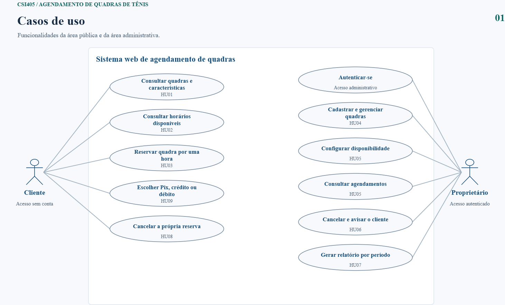
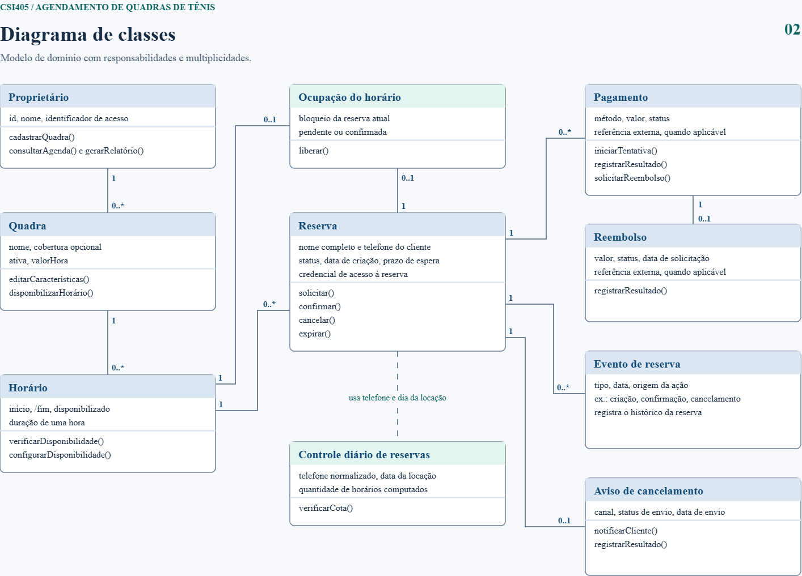
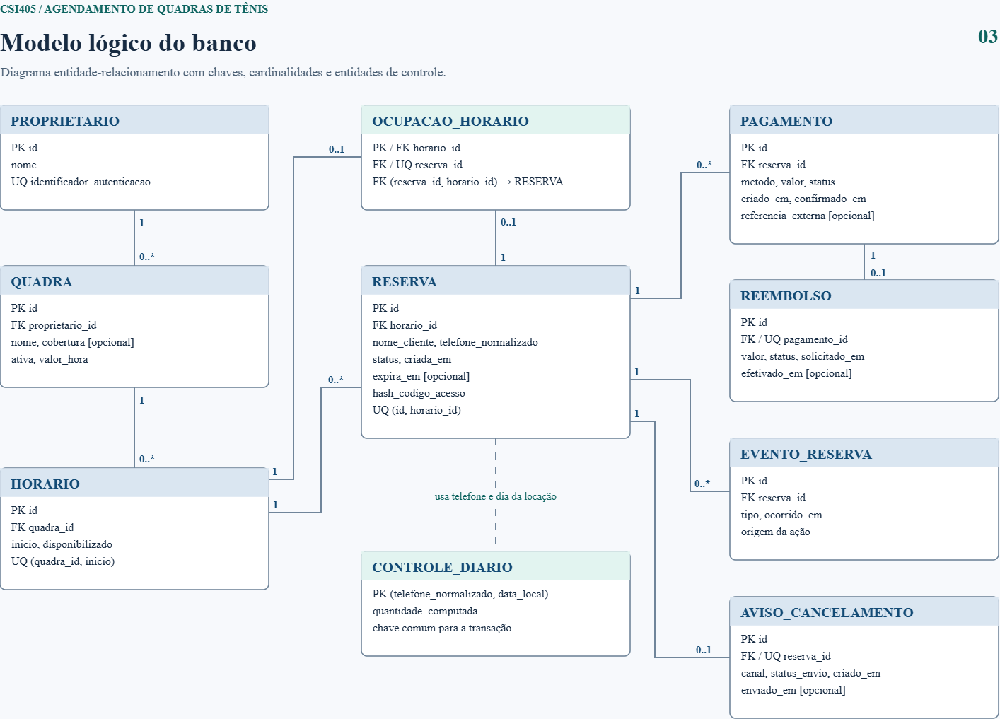

# AceCourt — Como rodar o projeto

## 1. Instale o Flutter

1. Instale o Git e abra o VS Code com a extensão **Flutter**.
2. Abra a paleta de comandos com **Ctrl+Shift+P** no Windows ou Linux, ou **Cmd+Shift+P** no macOS. Selecione **Flutter: New Project** → **Download SDK**, escolha onde instalar e clique em **Clone Flutter**. Quando o download terminar, selecione **Add SDK to PATH**. [Guia oficial do Flutter](https://docs.flutter.dev/install/with-vs-code).
3. Feche e reabra o VS Code. Rode `flutter doctor` no terminal. Para rodar a interface web, tenha o Google Chrome instalado.

Abra no VS Code a pasta do AceCourt que o grupo está usando.

## 2. Crie o banco e as tabelas

1. Instale o [PostgreSQL 18](https://www.postgresql.org/download/) e o pgAdmin. No Windows, o [instalador do PostgreSQL](https://www.postgresql.org/download/windows/) inclui o pgAdmin.
2. No pgAdmin, conecte-se ao PostgreSQL local com o usuário `postgres` e a senha da sua instalação.
3. Em **Databases → Create → Database**, crie um banco vazio chamado `acecourt`.
4. Abra o **Query Tool** do banco `acecourt` e execute estes dois arquivos completos, na ordem indicada.

   1. [`banco/01_modelagem.sql`](banco/01_modelagem.sql)
   2. [`banco/02_trava_anti_duplicidade.sql`](banco/02_trava_anti_duplicidade.sql)

Execute os scripts uma vez por banco novo. Nas próximas vezes, comece pela execução da API.

## 3. Rode a API

No Windows, abra o PowerShell na raiz do projeto. Digite a senha local do PostgreSQL quando o terminal pedir.

```powershell
cd api
dart pub get
$env:ACECOURT_DB_NOME = 'acecourt'
$senha = Read-Host 'Senha do PostgreSQL' -AsSecureString
$env:ACECOURT_DB_SENHA = [System.Net.NetworkCredential]::new('', $senha).Password
dart run servidor.dart
```

No Linux ou macOS, abra o Bash na raiz do projeto.

```bash
cd api
dart pub get
export ACECOURT_DB_NOME=acecourt
read -rsp 'Senha do PostgreSQL: ' ACECOURT_DB_SENHA
printf '\n'
export ACECOURT_DB_SENHA
dart run servidor.dart
```

A API usa o PostgreSQL local na porta `5432` e fica disponível em [http://127.0.0.1:8080/quadras](http://127.0.0.1:8080/quadras). Deixe esse terminal aberto enquanto usa o projeto.

## 4. Rode a interface Flutter Web

Com a interface disponível no repositório, abra um segundo terminal na pasta do aplicativo Flutter que contém `lib/main.dart` e `pubspec.yaml`. Rode os comandos abaixo.

```bash
flutter pub get
flutter run -d chrome
```

## Diagramas

<!--
Salve as imagens na pasta diagramas/ e ajuste os nomes abaixo.
Remova os delimitadores deste comentário para exibir as imagens no README.




-->
